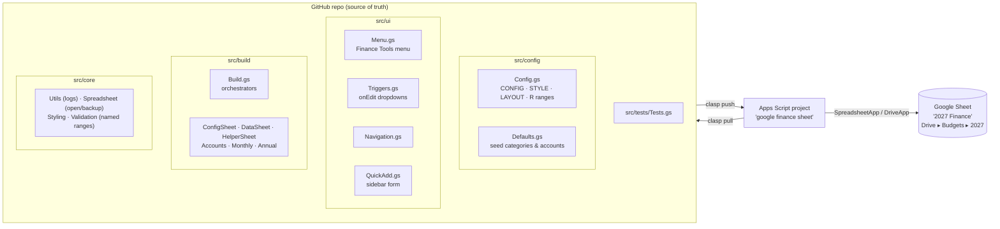
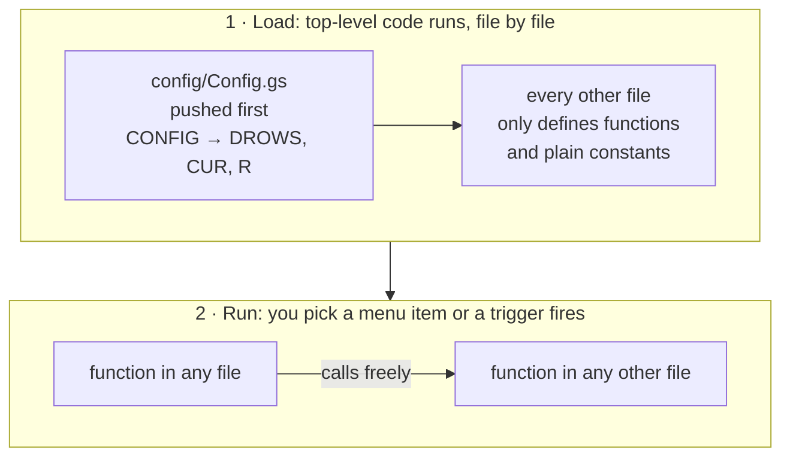
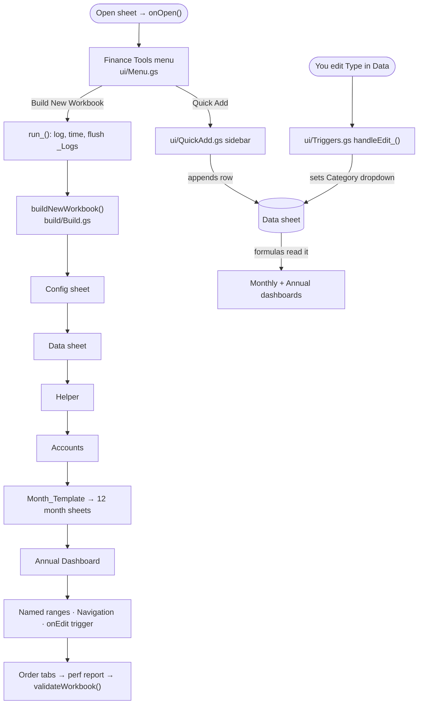

# personal-finance-workbook

Google Apps Script that builds and maintains the yearly finance workbook in Google Sheets (currently "2027 Finance")
(Config, Data, monthly dashboards, Accounts, Annual Dashboard, Quick-Add sidebar).

The live script is the standalone Apps Script project **"google finance sheet"**
(Drive ▸ Budgets ▸ scripts). This repo is its source of truth from now on: edit here, then
`clasp push`.

## Layout

```
src/
  appsscript.json        manifest (timezone, V8 runtime)
  config/Config.gs       CONFIG, STYLE, LAYOUT, derived ranges (R) — the settings you edit
  config/Defaults.gs     seed categories and accounts (used only on first build)
  core/                  Utils (logging), Spreadsheet (open/backup), Styling, Validation
  build/                 one file per sheet builder; Build.gs runs them in order
  ui/                    Menu, Triggers (onEdit), Navigation, QuickAdd sidebar
  tests/Tests.gs         runVerificationTests (in-sheet tests)
tests/node/              Node tests with a SpreadsheetApp stand-in (npm test)
```

Apps Script has **no imports**: every `.gs` file is loaded into one shared global scope, so
any function can call any other function in any file. The one catch is code *outside*
functions, which runs when files load. Keep all of that in `config/Config.gs` (it is pushed
first via `filePushOrder`), and only plain literals elsewhere.

## How it works

### What lives where



### One shared scope, no imports

Apps Script joins all the `.gs` files into one global scope before anything runs. Any
function can call any function in any file, so there is nothing to import.



Rule: code **outside** a function may only use names from `config/Config.gs` or its own
file. Code **inside** functions can use anything.

### What happens when you click a menu item



## Testing

**Step-by-step guide, including how to run the tests from the script editor and how to read
`Test_Report`: [docs/testing.md](docs/testing.md).**

There are two test suites. Neither touches your real workbook's data.

**1. Node tests (`npm test`)** run on your computer and on every push (GitHub Actions ▸ Tests).
They load every `src/**/*.gs` file into Node with a stand-in for `SpreadsheetApp`
(`tests/node/gas-mock.js`). The stand-in stores values and formulas but cannot calculate
formulas, so these tests check what the script *writes*: sheet order, headers, formulas,
dropdowns, named ranges, triggers, and how each function reacts to bad input. Needs Node 20+;
no install step.

```
npm test
```

**2. In-sheet tests (Finance Tools ▸ Run Verification Tests, or `menuRunTests` in the script
editor for a standalone script)** run inside Google Sheets, where formulas really calculate. The suite builds a throwaway workbook, fills it with a small known
set of transactions, checks the numbers every sheet shows, and writes the results to a
`Test_Report` sheet in your finance workbook. If everything passes, the throwaway
workbook goes to the Drive trash; if anything fails, it is kept and its link is in the report.
Your real onEdit trigger is never reinstalled during a test run.

Apps Script stops any single run at 6 minutes, and the suite builds a whole workbook, so it
watches the clock. After about 4½ minutes it finishes the group it is on, saves its place, and
stops with "PAUSED" at the top of `Test_Report`. Run **Finance Tools ▸ Resume Verification
Tests** to carry on; repeat until the report shows the final pass/fail count. If Google kills a
run anyway, `Test_Report` still has every result up to the group that was cut off, and Resume
continues after it (finishing the build if that was the step cut off). Starting **Run
Verification Tests** again instead throws away the paused run and starts over. Only these two
menu items run the tests; no trigger does.

### Scenarios covered

| Area | Node tests | In-sheet tests |
| --- | --- | --- |
| Build from scratch: every sheet created, in order, hidden helpers hidden | ✓ | ✓ |
| Config seeded with default categories and accounts; no duplicates or stray spaces | ✓ | ✓ |
| Data sheet: headers, Month/Parent/Sub/key formulas, Type/Category/Account dropdowns | ✓ | ✓ |
| Monthly KPI cards: opening balance, income, expense, net, savings rate, budget | | ✓ |
| Budget vs Actual for expense and income categories | | ✓ |
| Transfers between accounts (counted in neither income nor expense) | | ✓ |
| Monthly account balances, carry-forward from the previous month, NET | ✓ (formula) | ✓ |
| Monthly transaction list, including an empty month | | ✓ |
| Refund entered as a negative expense | | ✓ |
| Accounts sheet: year-to-date balances per account and NET | | ✓ |
| Annual Dashboard: totals, averages, top categories, best month, health score, net worth | | ✓ |
| Navigation links between month sheets | ✓ | ✓ |
| Dependent Category dropdown when Type changes; warnings for incomplete rows | ✓ | ✓ |
| Quick Add: first empty row, formula columns untouched, transfers, bad amount or date | ✓ | ✓ |
| Running the build twice: Config edits kept, Data backed up, missing defaults re-added | ✓ | |
| Rebuild modes: BACKUP, SKIP, DELETE | ✓ | |
| A month sheet deleted, then Validate and Resume | ✓ | ✓ |
| A row dated next year is left out of this year's totals | | ✓ |
| A wrong Drive folder ID stops with a clear error | ✓ | ✓ |
| Only one onEdit trigger installed; none during a test run | ✓ | ✓ |
| The test suite itself leaves the host workbook alone except for `Test_Report` | ✓ | |
| Test suite under the 6-minute limit: pause, resume, killed mid-build, killed mid-group | ✓ | ✓ |
| Nothing runs the tests automatically | ✓ | |

## Connect to GitHub with clasp

`clasp` is Google's command-line tool that copies files between this folder and the Apps
Script project.

One-time setup (on your Mac):

```sh
npm install -g @google/clasp            # needs Node.js 18+
clasp login                             # opens a browser; sign in with the Google account that owns the script
```

Also turn on the Apps Script API once: https://script.google.com/home/usersettings

Then, from a clone of this repo:

```sh
clasp push        # upload src/ to the Apps Script project (replaces ALL files there)
clasp open        # open the project in the browser editor
```

Daily loop: edit in `src/`, `clasp push`, run from the editor, then `git commit` and
`git push`.

### First push: read this

- `clasp push` makes the online project match `src/` exactly. The old single `Code.gs`
  disappears and the split files appear (as `config/Config`, `build/Monthly`, ...). The
  code is identical, just moved.
- Anything changed in the browser editor and not yet in git is overwritten. Before the
  first push, make a copy of the project (Overview ▸ Make a copy) as a backup.
- After that, don't edit in the browser. If you do, run `clasp pull` and commit before your
  next push.

### Secrets and IDs

`.clasp.json` contains the script ID, and `config/Config.gs` contains the Drive folder ID.
Neither is a password: both are useless without signing in to your Google account. Your
real credential is `~/.clasprc.json` (created by `clasp login`). It lives in your home
folder, is git-ignored, and must never be committed. If this repo is public and you'd
rather hide the IDs anyway, make the repo private.

### Optional: push from GitHub Actions

How the login token works, what it can access, and how to revoke it:
[docs/authentication.md](docs/authentication.md).

`.github/workflows/clasp-push.yml` runs `clasp push` when you start it by hand
(Actions ▸ Push to Apps Script ▸ Run workflow). It never runs on its own. To enable it, add
a repository secret named `CLASPRC_JSON` containing the contents of your `~/.clasprc.json`.
That token can edit your Apps Script projects, so only do this if the repo is private or you
are the only person with write access.
