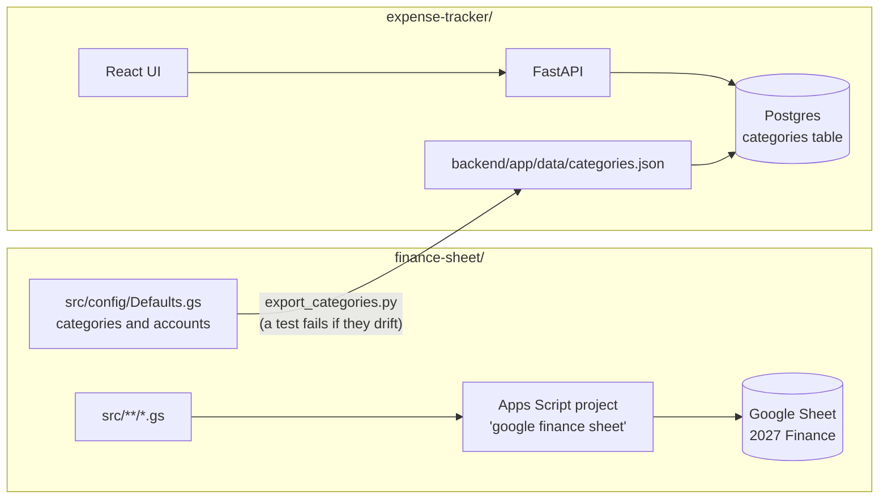

# personal-finance-workbook

My personal finance tooling. Two products live in this repo, each in its own folder with its own README.

| | [Finance sheet](finance-sheet/README.md) | [Expense tracker](expense-tracker/README.md) |
| --- | --- | --- |
| What it is | Google Apps Script that builds the yearly finance workbook ("2027 Finance") in Google Sheets | Web app for daily expense entry, budgets and dashboards, with households and multiple users |
| Folder | `finance-sheet/` | `expense-tracker/` |
| Stack | Apps Script (V8), clasp, Node tests | FastAPI, Postgres 16, React + Vite, Docker Compose |
| Runs on | Google Sheets (the "google finance sheet" script) | Docker on your Mac (http://localhost:8080) |
| Deploy | `cd finance-sheet && clasp push` | `cd expense-tracker && make up` |
| Test | `cd finance-sheet && npm test` | `cd expense-tracker && make test` |
| CI | Tests, Push to Apps Script (manual) | Expense tracker |

The expense tracker is meant to replace the finance sheet; until then, both are kept working.

## How they connect



The only shared piece is the category list. `finance-sheet/src/config/Defaults.gs` is the
source, and `expense-tracker/backend/scripts/export_categories.py` turns it into the app's
seed file. A change to `Defaults.gs` also runs the expense tracker's CI.

## Layout

```
.github/workflows/   CI for both products (GitHub only reads workflows from the repo root)
finance-sheet/       Apps Script source (src/), Node tests, clasp config, docs
expense-tracker/     backend/, frontend/, docker-compose, Makefile, docs/ (deploy, backup, restore, migration)
```
