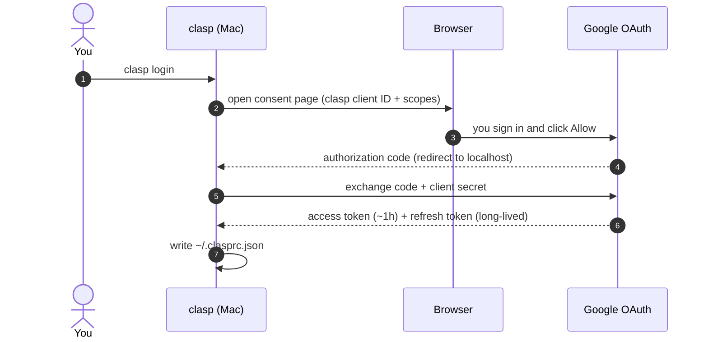
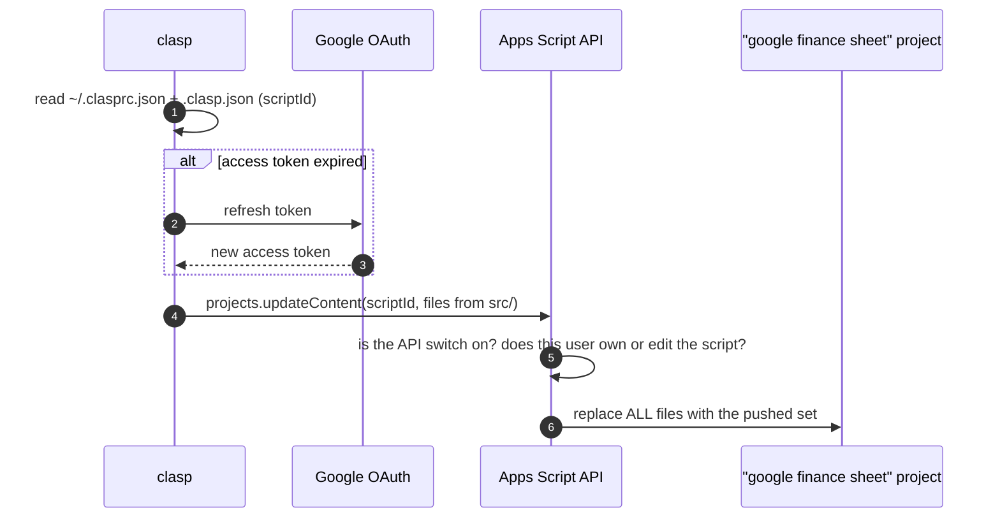
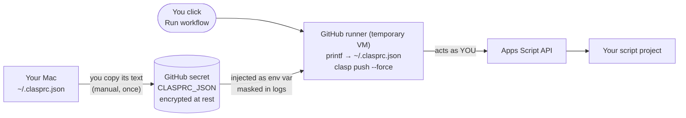

# How GitHub authenticates with Apps Script

**Short version:** GitHub never authenticates as itself. There is no trust link between
GitHub and Google here. `clasp login` gives *your* Google account's OAuth token to clasp.
The GitHub Action works only because you paste a copy of that token into a GitHub secret.
Whoever holds that token can act as you on the Apps Script API.

## The pieces

| Piece | What it is | Where it lives |
|---|---|---|
| clasp | Google's CLI that calls the **Apps Script API** (create, read and update script files) | `npm install -g @google/clasp` |
| OAuth client | clasp's built-in client ID and secret, owned by Google's clasp project. It identifies the *app*, not you | Inside clasp; clasp 2.x also copies it into `~/.clasprc.json` |
| Access token | Short-lived (about 1 hour) bearer token sent with every API call | `~/.clasprc.json` → `token.access_token` |
| Refresh token | Long-lived token that clasp trades for a new access token. **This is the real credential** | `~/.clasprc.json` → `token.refresh_token` |
| Apps Script API switch | A per-account setting. Without it, every API call fails with 403 "User has not enabled the Apps Script API" | https://script.google.com/home/usersettings |
| `scriptId` | Which project to push to. Not a secret; useless without a token | `.clasp.json` |
| `CLASPRC_JSON` | A GitHub repository secret holding the full text of your `~/.clasprc.json` | GitHub ▸ Settings ▸ Secrets and variables ▸ Actions |

## 1. One-time login on your Mac



## 2. Every `clasp push` (Mac or GitHub runner, same thing)



## 3. How the GitHub Action gets in



From `.github/workflows/clasp-push.yml`:

```yaml
- name: Write clasp credentials
  env:
    CLASPRC_JSON: ${{ secrets.CLASPRC_JSON }}
  run: printf '%s' "$CLASPRC_JSON" > ~/.clasprc.json
- run: clasp push --force
```

The runner is thrown away after the job, but for those few minutes it holds your token.

## What the token can do

clasp 2.x requests roughly these scopes (check the consent screen when you log in):
`script.projects`, `script.deployments`, `script.webapp.deploy`, `drive.file`,
`drive.metadata.readonly`, `logging.read`, `service.management`, `cloud-platform`,
`userinfo.email` and `userinfo.profile`.

What that means in practice:

- **Every** Apps Script project you can edit, not just this one, can be read, overwritten
  or deployed.
- The token can't read your spreadsheets directly. But the script it pushes runs **as you**
  the next time you click a menu item, and this script already has Sheets and Drive access.
  So anyone holding the token can plant code that reaches your finance data. Treat the token
  like your Google password for these purposes.
- `cloud-platform` is broad and covers Google Cloud projects in your account.

## When the token stops working

The refresh token has no fixed expiry. It stops working when:

- you remove access at https://myaccount.google.com/permissions (the entry is named after
  clasp / "Apps Script CLI"). **This is the kill switch.**
- it goes unused for 6 months.
- you run `clasp login` many times: Google keeps about 100 refresh tokens per app per
  account, and older ones get invalidated. A new `clasp login` alone does not kill the
  old token.
- Google or your account admin revokes it (for example after a security event).

`clasp logout` only deletes the local file. It does **not** revoke the token, so a copy in
GitHub keeps working.

## Risks of the GitHub Action on this repo

The repo being public is **not** the main risk. GitHub does not give secrets to pull
requests from forks, and this workflow only runs when someone with write access clicks
Run. The real risks are:

1. **Write access = your token.** Anyone who can push to the repo can add a workflow that
   prints or sends the secret elsewhere. Today that's only you, so keep it that way.
2. **Supply chain.** The job runs `npm install -g @google/clasp`, `actions/checkout` and
   `actions/setup-node`. If one of those is compromised, it runs with your token. Pinning
   the clasp version helps; pinning actions to a commit SHA helps more.
3. **Stale copy.** If you revoke or re-login on your Mac, the GitHub copy keeps working until
   you revoke it on the Google side.

## Safer options, best first

1. **Don't enable the Action.** Run `clasp push` from your Mac. The token never leaves
   your machine. For one person this is the right default.
2. **A dedicated Google account** that owns only this script and has edit access only to
   the Budgets/2026 folder. Put *its* token in GitHub. A leak then exposes one folder, not
   your whole account.
3. If you do use your own token: keep the repo's write access to yourself, pin the action
   SHAs, and revoke and replace the token if anything looks off.

A Google service account (the usual way to do CI without a personal token) does not help
here, because the Apps Script API does not accept service accounts for these calls.
