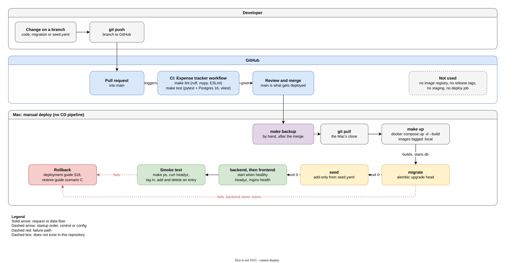
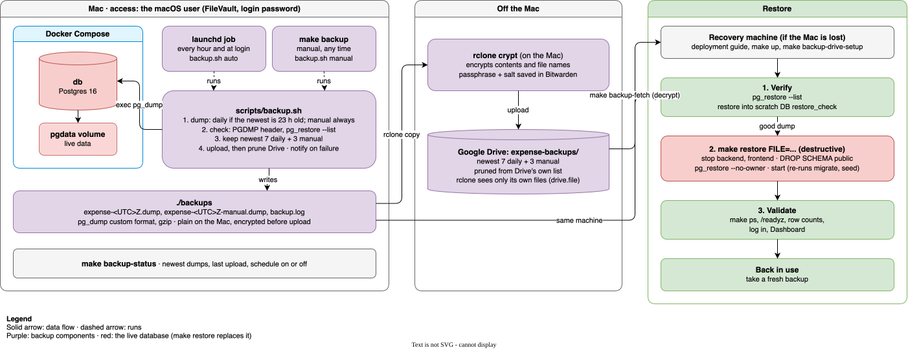
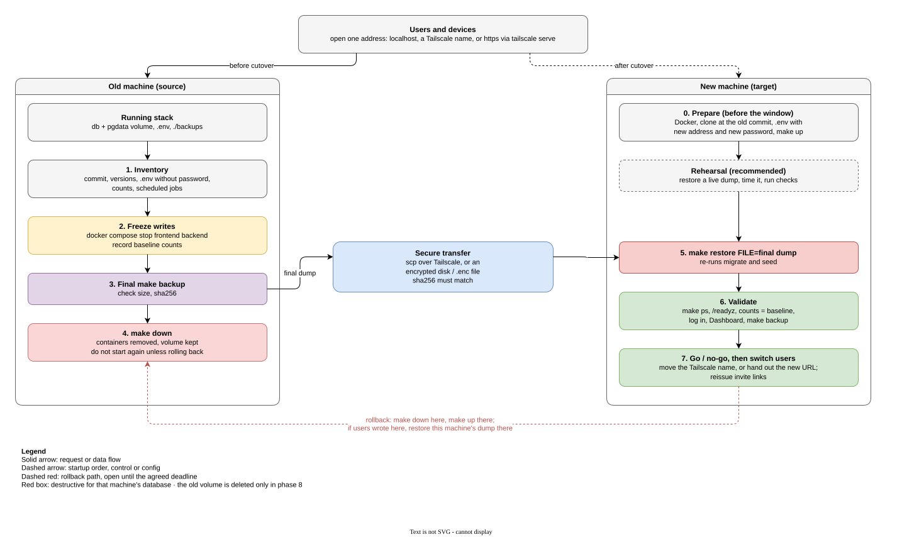

# Application and infrastructure architecture

How the expense tracker runs today, what each part depends on, and where it can fail. The
operational guides build on this page:

| Guide | Use it to |
| --- | --- |
| [Deployment guide](deployment-guide.md) | set up the app on a new machine, and deploy updates |
| [Backup guide](backup-guide.md) | take, check and store backups |
| [Restore guide](restore-guide.md) | recover from data loss or a bad deploy |
| [Environment migration guide](environment-migration-guide.md) | move everything to a new machine |
| [Quick reference](quick-reference-commands.md) | copy the commands without the explanations |

Each section separates **Current** (what the repository does now) from **Recommended** (not
built yet). Nothing under Recommended runs today.

## Scope

This covers the web app in `expense-tracker/`. The Apps Script finance sheet in
`finance-sheet/` is a separate product with its own [README](../../finance-sheet/README.md),
and none of these guides apply to it.

## System overview

There is one environment. It runs on one Mac under Docker Desktop, started with
`docker compose` through the `Makefile`. There is no cloud account, no Terraform, no
Kubernetes, no load balancer and no DNS record. A cloud or EKS move is an idea for later,
not something in the repository.


Source: [diagrams/system-architecture.drawio.svg](diagrams/system-architecture.drawio.svg)
(open it in draw.io to edit).

```text
browser ──► frontend (nginx, :8080) ──/api──► backend (FastAPI, :8000) ──► db (Postgres 16)
                                                       ▲                       │
                       migrate (one-shot: alembic upgrade head, then exits)    │ pgdata volume
                       seed    (one-shot: adds what's missing from config/seed.yaml)
```

Backups run outside Compose: `scripts/backup.sh`, started hourly by launchd, takes a daily
`pg_dump` through `docker compose exec db` and copies it, encrypted, to Google Drive.

## Components

All services are defined in [`docker-compose.yml`](../docker-compose.yml). The Compose
project is named `expense-tracker`, so containers are `expense-tracker-<service>-1` and the
data volume is `expense-tracker_pgdata`.

| Service | Image | What it does | Depends on | Talks to | Restart |
| --- | --- | --- | --- | --- | --- |
| `db` | `postgres:16-alpine` | Holds all data. Not published to the host. | `pgdata` volume, `.env` | nothing outbound | `unless-stopped` |
| `migrate` | `expense-tracker-backend:local` (built from `backend/`) | Runs `alembic upgrade head`, then exits. The backend starts only if it exits 0. | `db` healthy | `db:5432` | `no` |
| `seed` | same backend image | Runs `python -m app.cli seed-config`: adds accounts, categories and settings from `config/seed.yaml` that are missing. Never changes or deletes. | `migrate` done | `db:5432` | `no` |
| `backend` | same backend image | FastAPI under `/api/v1`, plus `/healthz`, `/readyz`, `/metrics`. Runs as a non-root user. | `db` healthy, `seed` done | `db:5432` | `unless-stopped` |
| `frontend` | `expense-tracker-frontend:local` (built from `frontend/`) | nginx (unprivileged) serves the built React app and proxies `/api/` to `backend:8000`. | `backend` healthy | `backend:8000` | `unless-stopped` |

Health checks:

| Check | Where it is defined | What it tests |
| --- | --- | --- |
| `pg_isready` | `docker-compose.yml`, `db` | Postgres accepts connections |
| `GET /readyz` | `backend/Dockerfile` `HEALTHCHECK` | The backend can run `SELECT 1` on the database (503 if not) |
| `GET /healthz` | `backend/app/main.py` | The backend process answers (no database check) |
| `GET /nginx-health` | `frontend/Dockerfile` `HEALTHCHECK`, `frontend/nginx.conf` | nginx answers |

### Backend

Python 3.12, FastAPI, Pydantic v2, SQLAlchemy 2 and Alembic, with dependencies locked in
`backend/uv.lock`. Settings come only from environment variables (`backend/app/config.py`).
The backend never changes the schema itself; only the `migrate` container does.

### Frontend

React, TypeScript and Vite. The Docker build runs `npm ci` and `npm run build` once, and
nginx serves the static files. `frontend/nginx.conf` adds `X-Content-Type-Options`,
`X-Frame-Options` and `Referrer-Policy` headers and caches `/assets/` for a year.

### Database

One Postgres 16 database. The name, user and password come from `.env` (`POSTGRES_DB`,
`POSTGRES_USER`, `POSTGRES_PASSWORD`). The user is the container's superuser, and the app
connects with it. No extensions are installed: `gen_random_uuid()` is built into
Postgres 13 and later. The schema comes from the migrations in
`backend/alembic/versions/` (0001 to 0009 at the time of writing).

## Request flow

1. The browser opens `http://<host>:8080`. `<host>` is `localhost` on the Mac, or the Mac's
   Tailscale name from another device.
2. nginx returns `index.html` and the JavaScript and CSS files.
3. The app calls a relative `/api/v1/...`. nginx proxies it to `backend:8000` on the
   Compose network, adding `X-Forwarded-*` and `X-Request-ID` headers.
4. The backend checks the session cookie, scopes the query to the caller's household, and
   reads or writes Postgres through a pool of 5 connections.

The browser only ever talks to nginx, so the app needs no CORS (see
[the README](../README.md#cors-and-why-this-app-doesnt-need-it)).

## Storage and data

| Data | Where it lives | In git? | Lost if |
| --- | --- | --- | --- |
| Users, households, accounts, categories, transactions, budgets, rules, sessions, invites | Docker volume `expense-tracker_pgdata` | No | the volume is deleted (`docker compose down -v`, `docker volume rm`, resetting Docker Desktop) or the Mac's disk fails |
| Database dumps | `expense-tracker/backups/` on the Mac, and encrypted in Google Drive (`expense-backups/`) | No (gitignored) | both the Mac and the Google account are lost, or the passphrase in Bitwarden is lost |
| `.env` (database password, ports, URLs) | `expense-tracker/.env` | No (gitignored) | the Mac's disk fails |
| Seed config, code, migrations | `config/seed.yaml` and the rest of the repository | Yes | not lost: it is on GitHub |
| Built images | Docker Desktop's image store | No registry | rebuilt by `make up` |

The app stores no uploaded files and uses no object storage. Everything a user enters goes
into Postgres.

## External services

| Service | Used for | When |
| --- | --- | --- |
| Docker Hub | Base images: `postgres:16-alpine`, `python:3.12-slim`, `node:22-alpine`, `nginxinc/nginx-unprivileged:1.27-alpine` | Build and first start |
| PyPI and npm | Backend and frontend dependencies | Build only |
| GitHub | Source code, and CI (GitHub Actions) | Deploy and every push |
| Tailscale (optional) | Reaching the app from a phone or another laptop | Runtime, on the host, outside Docker |

At runtime the containers make no outbound calls. The app sends no email: invite and
password-reset links are shown in the app, and you send them yourself.

## Authentication and authorization

- Logins create a server-side session: an HttpOnly, SameSite=Lax cookie holding a random
  token. Only its SHA-256 hash is stored, in the `sessions` table. Sessions slide for 30
  days (`SESSION_TTL_DAYS`).
- Passwords are hashed with argon2. Five failed logins in 15 minutes lock that email for the
  rest of the window.
- Every write must send an `X-Requested-With` header.
- Every query is scoped to the caller's household. Site admins (`is_site_admin`) also get
  the Admin pages.
- The first admin is created from the command line (`make create-admin`). Everyone else
  joins through an invite link.

There is no external identity provider and no signing key to manage. Because sessions and
password hashes live in the database, a restored backup brings back every login.

## Networking, DNS and TLS

| Item | Current |
| --- | --- |
| frontend port | `0.0.0.0:${FRONTEND_PORT:-8080}`: reachable from the Mac, the tailnet, **and anyone on the same Wi-Fi** |
| backend port | `127.0.0.1:${BACKEND_PORT:-8000}`: the Mac only (Swagger, health, metrics) |
| db port | not published; only containers on the Compose network reach it |
| DNS | none; `localhost` on the Mac, or Tailscale MagicDNS from other devices |
| TLS | none; plain HTTP. Tailscale encrypts traffic between tailnet devices; Wi-Fi traffic is not encrypted |
| Firewall | the macOS application firewall, if it is on |
| Load balancer, ingress, reverse proxy in front of nginx | not used |

`.env.example` still says both ports bind to `127.0.0.1`; that comment is out of date.

**Recommended:** put `127.0.0.1:` back on the frontend port and use `tailscale serve` for
HTTPS on the tailnet, with `PUBLIC_BASE_URL` set to the `https://` address and
`COOKIE_SECURE=true`. The README's Tailscale section describes this.

## Deployment pipeline and release flow



Source: [diagrams/deployment-flow.drawio.svg](diagrams/deployment-flow.drawio.svg).

- **CI (current):** `.github/workflows/expense-tracker.yml` runs `make lint` and `make test`
  on every push or pull request that touches `expense-tracker/`,
  `finance-sheet/src/config/Defaults.gs` or the workflow file. It does not build release
  images and does not deploy.
- **Deploy (current):** manual, on the Mac: take a backup, `git pull`, `make up`. Images are
  built locally and tagged `:local`; there is no registry and no versioned release artifact.
  The deployed version is whatever commit the Mac's clone has checked out.
- **Environments:** one, on the Mac (`APP_ENV=production`). `make test` and `make lint` use
  throwaway containers (`docker-compose.test.yml`, project `expense-tracker-test`) with their
  own Postgres in tmpfs. Local development runs uvicorn and Vite outside Docker (see the
  README). There is no staging environment.

## Backup and restore



Source: [diagrams/backup-restore-architecture.drawio.svg](diagrams/backup-restore-architecture.drawio.svg).

- `scripts/backup.sh` runs on the Mac, outside Compose. A launchd job runs it hourly and it
  takes a daily `pg_dump --format=custom` into `expense-tracker/backups/`; `make backup`
  takes a manual one. Each dump is checked, encrypted with rclone `crypt` and copied to
  Google Drive. The newest 7 daily and 3 manual dumps are kept on each side.
- `make restore FILE=...` replaces the database with a dump; `make backup-fetch` gets one
  back from Drive. Details and remaining gaps are in the
  [backup guide](backup-guide.md#known-gaps). There is no automatic restore test.

## Monitoring, logging and alerting

| Item | Current |
| --- | --- |
| Logs | JSON lines on stdout, kept by Docker's default log driver; `make logs` to read them. They carry the route template, status and timing, and never amounts, descriptions or emails. Removing a container (`make down`) removes its logs |
| Metrics | Prometheus format at `http://localhost:8000/metrics`. Nothing scrapes it |
| Health | Docker health checks, shown by `make ps` |
| Alerting | A failed backup or upload shows a macOS notification. A stopped container or a full disk alerts nobody |

`make backup-status` shows whether the daily backup is due and when Drive was last updated
(see the [backup guide](backup-guide.md#record-and-monitor-backup-results)).

## Security boundaries and secrets

- The only secret is `POSTGRES_PASSWORD` in `.env`. `make up` generates it on the first run
  (`openssl rand -hex 24`). It is gitignored, and only the containers use it.
- Backups and the `pgdata` volume hold everything that matters: financial entries, email
  addresses, password hashes and session token hashes. Treat them as sensitive. Today they
  are unencrypted files on the Mac's disk.
- Trust boundaries: browser to nginx (HTTP, open to the Wi-Fi), nginx to backend (Compose
  network), backend to db (Compose network, password auth).
- No credentials, hostnames or IP addresses belong in these docs or diagrams. Use
  placeholders.

## Single points of failure

| Failure | Effect | Recovery today |
| --- | --- | --- |
| Mac disk failure, loss or theft | App, data and local backups gone | The Drive copies: [restore guide, scenario D](restore-guide.md#d-the-machine-is-lost). Needs the passphrase from Bitwarden |
| `docker compose down -v` or a Docker Desktop reset | Database gone, backups kept | [Restore guide, scenario B](restore-guide.md#b-the-database-volume-is-gone) |
| Mac asleep or Docker Desktop stopped | App unreachable; the daily backup waits | Wake the Mac, start Docker Desktop. The containers restart on their own, and the next hourly check takes the missed backup |
| A bad deploy (code or migration) | App down or wrong | [Restore guide, scenario C](restore-guide.md#c-a-deploy-failed) |
| Docker Hub, PyPI or npm unreachable | `make up --build` cannot build, the running app keeps working | Wait, or keep the old images (don't prune them) |

There is no redundancy: one machine, one database, no replica.

## Recovery and migration

- RPO and RTO targets have not been agreed. The [restore guide](restore-guide.md#recovery-objectives)
  lists what the current setup can achieve and the values to decide.
- Moving to a new machine is a dump, copy and restore. There is no live replication, so it
  needs a short freeze on writes. See the
  [environment migration guide](environment-migration-guide.md) and its diagram:



Source: [diagrams/environment-migration.drawio.svg](diagrams/environment-migration.drawio.svg).

## Diagrams

All four are draw.io files with the image and the editable diagram in one file, like the
other diagrams in [`diagrams/`](diagrams). Open one in draw.io (desktop or
app.diagrams.net), edit it, and save; GitHub shows the updated image.

| File | Shows |
| --- | --- |
| [system-architecture.drawio.svg](diagrams/system-architecture.drawio.svg) | Clients, network, the Mac, Docker Compose services, storage, and build-time services |
| [deployment-flow.drawio.svg](diagrams/deployment-flow.drawio.svg) | Change, CI, merge, and the manual deploy on the Mac |
| [backup-restore-architecture.drawio.svg](diagrams/backup-restore-architecture.drawio.svg) | The backup script, its schedule, the encrypted Drive copy, and both restore paths |
| [environment-migration.drawio.svg](diagrams/environment-migration.drawio.svg) | Moving from the old machine to a new one, with the rollback path |
