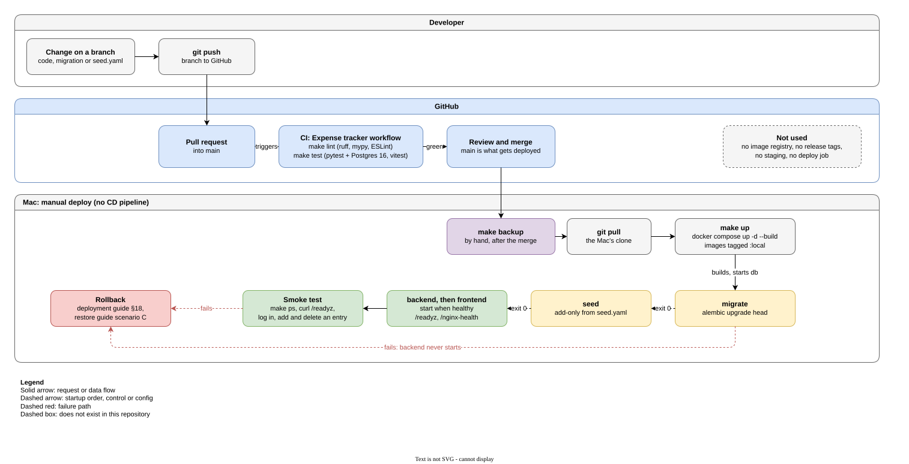
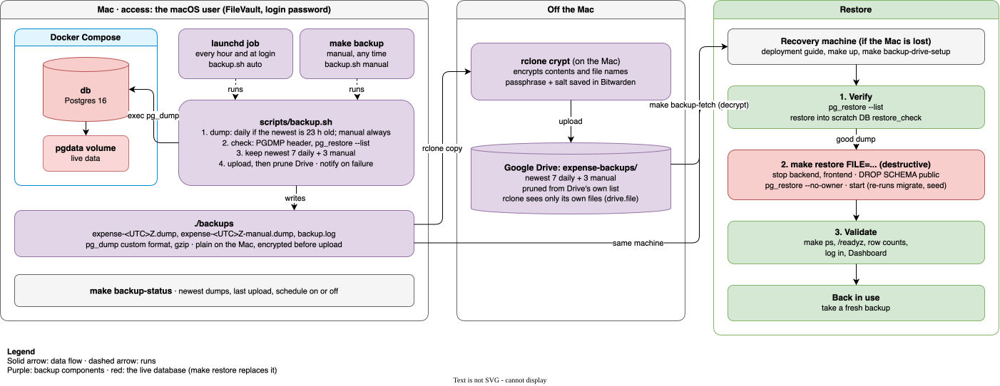
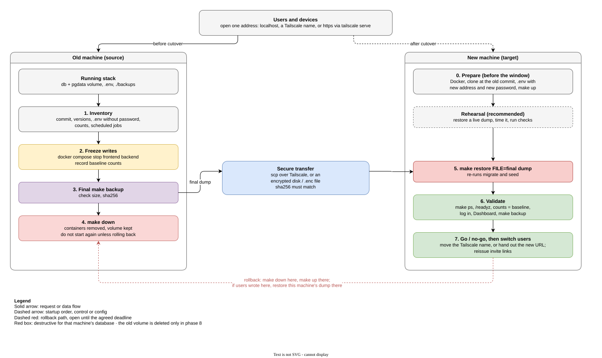

# Application and infrastructure architecture

How the expense tracker runs today, what each part depends on, and where it can fail. The
operational guides build on this page:

| Guide | Use it to |
| --- | --- |
| [Server setup guide](server-setup-guide.md) | set up the droplet, connect GitHub, deploy, add HTTPS, move servers |
| [Deployment guide](deployment-guide.md) | understand each deploy step, on a server or on a Mac |
| [Backup guide](backup-guide.md) | take, check and store backups |
| [Restore guide](restore-guide.md) | recover from data loss or a bad deploy |
| [Environment migration guide](environment-migration-guide.md) | move everything to a new machine |
| [Quick reference](quick-reference-commands.md) | copy the commands without the explanations |

Each section separates **Current** (what runs now) from **Recommended** (not built yet).
Nothing under Recommended runs today.

## Scope

This covers the web app in `expense-tracker/`. The Apps Script finance sheet in
`finance-sheet/` is a separate product with its own [README](../../finance-sheet/README.md),
and none of these guides apply to it.

## System overview

There is one production environment: a small DigitalOcean droplet that runs the app with
Docker Compose, reached at `https://<name>.duckdns.org`. GitHub Actions builds the images and
starts every deploy; the server only pulls images and runs them. Backups leave the server
every day, encrypted, for Google Drive.


Source: [diagrams/production-architecture.drawio.svg](diagrams/production-architecture.drawio.svg).
It is the image and the editable diagram in one file: open it in draw.io, edit, and save.

```text
browser ──HTTPS──► caddy (:80, :443) ──► frontend (nginx, 127.0.0.1:8080) ──/api──► backend (FastAPI) ──► db (Postgres 16)
                                                                                     ▲
                        migrate (one-shot: alembic upgrade head, then exits)          │
                        seed    (one-shot: adds what's missing from config/seed.yaml) │

GitHub Actions ──build, push──► Docker Hub ◄──pull── droplet
GitHub Actions ──ssh "deploy sha-<commit>"──► droplet (deploy-gate.sh → deploy.sh)
cron (hourly) ──► backup.sh ──pg_dump──► backups/ ──rclone crypt──► Google Drive
```

The Mac is now the development machine. It still runs the same app with `make up` and
`docker-compose.yml` (images built locally), and its old data volume is kept as a fallback.
Its backup schedule is off. Since the move, the server holds the real data.

## Components

The server's services are defined in
[`docker-compose.deploy.yml`](../docker-compose.deploy.yml). The Compose project is named
`expense-tracker`, so containers are `expense-tracker-<service>-1` and the data volume is
`expense-tracker_pgdata`, on the Mac and on the server alike.

| Service | Image | What it does | Depends on | Memory limit | Restart |
| --- | --- | --- | --- | --- | --- |
| `caddy` | `caddy:2.10-alpine` | HTTPS for `CADDY_DOMAIN`: gets and renews a Let's Encrypt certificate, redirects `http://` to `https://`, proxies to `frontend:8080`. The only service with public ports (80, 443). On only when `.env` has `COMPOSE_PROFILES=https` | `frontend` started | 64 MB | `unless-stopped` |
| `frontend` | `<dockerhub-user>/expense-tracker-frontend:<tag>` | nginx (unprivileged) serves the built React app and proxies `/api/` to `backend:8000`. Bound to `127.0.0.1:8080` | `backend` healthy | 64 MB | `unless-stopped` |
| `backend` | `<dockerhub-user>/expense-tracker-backend:<tag>` | FastAPI under `/api/v1`, plus `/healthz`, `/readyz`, `/metrics`. Runs as a non-root user. Not published on the host | `db` healthy, `seed` done | 320 MB | `unless-stopped` |
| `migrate` | same backend image | Runs `alembic upgrade head`, then exits. The backend starts only if it exits 0 | `db` healthy | 320 MB | `no` |
| `seed` | same backend image | Runs `python -m app.cli seed-config`: adds accounts, categories and settings from the `config/seed.yaml` baked into the image that are missing. Never changes or deletes | `migrate` done | 320 MB | `no` |
| `db` | `postgres:16-alpine` | Holds all data. Not published to the host. Tuned for a small machine: `shared_buffers=48MB`, `max_connections=30` | `pgdata` volume, `.env` | 256 MB | `unless-stopped` |

Every container's logs are capped at 10 MB × 3 files. On the Mac, `docker-compose.yml` runs
the same app services without Caddy or memory limits, builds the images itself (tagged
`:local`) and mounts `config/` over the baked-in seed.

Health checks:

| Check | Where it is defined | What it tests |
| --- | --- | --- |
| `pg_isready` | the compose files, `db` | Postgres accepts connections |
| `GET /readyz` | `backend/Dockerfile` `HEALTHCHECK` | The backend can run `SELECT 1` on the database (503 if not) |
| `GET /healthz` | `backend/app/main.py` | The backend process answers (no database check) |
| `GET /nginx-health` | `frontend/Dockerfile` `HEALTHCHECK`, `frontend/nginx.conf` | nginx answers |

`scripts/deploy.sh` waits for all of them (`docker compose up --wait`), then checks
`/nginx-health` and that `/api/v1/auth/me` answers 401 through nginx.

### Server (host)

| Item | Current |
| --- | --- |
| Machine | DigitalOcean droplet, Ubuntu on x86-64, 1 vCPU, 512 MB RAM, plus a 2 GB swap file (`vm.swappiness=10`). The 1 GB size is the fix if it gets slow |
| Software | Docker Engine with the Compose plugin, fail2ban, rclone. No clone of the repository, no `make` |
| SSH | Keys only, no passwords; root only with a key. The `deploy` user runs the app and is in the `docker` group |
| App folder | `/home/deploy/expense-tracker`: `docker-compose.deploy.yml`, `.env` (mode 600), `scripts/` (`deploy-gate.sh`, `deploy.sh`, `backup.sh`), `backups/` |
| Schedules | The `deploy` user's crontab runs `scripts/backup.sh auto` every hour at minute 17 |

### Backend

Python 3.12, FastAPI, Pydantic v2, SQLAlchemy 2 and Alembic, with dependencies locked in
`backend/uv.lock`. Settings come only from environment variables (`backend/app/config.py`).
The backend never changes the schema itself; only the `migrate` container does.

### Frontend

React, TypeScript and Vite. The image build runs `npm ci` and `npm run build` once, and
nginx serves the static files. `frontend/nginx.conf` adds `X-Content-Type-Options`,
`X-Frame-Options` and `Referrer-Policy` headers and caches `/assets/` for a year.

### Database

One Postgres 16 database. The name, user and password come from `.env` (`POSTGRES_DB`,
`POSTGRES_USER`, `POSTGRES_PASSWORD`). The user is the container's superuser, and the app
connects with it. No extensions are installed: `gen_random_uuid()` is built into
Postgres 13 and later. The schema comes from the migrations in
`backend/alembic/versions/`. A deploy never upgrades the Postgres image: `deploy.sh` pulls
only the app images.

## Request flow

1. The browser looks up `<name>.duckdns.org`. DuckDNS answers with the droplet's public IP
   (an A record set once by hand; the droplet's IP doesn't change).
2. The DigitalOcean cloud firewall lets TCP 80 and 443 through. Caddy answers on 443 with
   the Let's Encrypt certificate, and redirects any `http://` request to `https://`.
3. Caddy proxies to `frontend:8080` on the Compose network. nginx returns `index.html` and
   the JavaScript and CSS files.
4. The app calls a relative `/api/v1/...`. nginx proxies it to `backend:8000`, adding
   `X-Forwarded-*` and `X-Request-ID` headers.
5. The backend checks the session cookie, scopes the query to the caller's household and
   their visible accounts, and reads or writes Postgres through a pool of 5 connections.

The browser only ever talks to one origin, so the app needs no CORS (see
[the README](../README.md#cors-and-why-this-app-doesnt-need-it)).

## Storage and data

| Data | Where it lives | In git? | Lost if |
| --- | --- | --- | --- |
| Users, households, accounts, categories, transactions, budgets, rules, sessions, invites | Docker volume `expense-tracker_pgdata` on the droplet | No | the volume is deleted (`docker compose down -v`, `docker volume rm`, `docker system prune --volumes`) or the droplet is destroyed |
| TLS certificates | Docker volume `expense-tracker_caddy_data` | No | the volume is deleted. Caddy then asks for new ones; too many fresh starts hit Let's Encrypt's weekly limit |
| Database dumps | `/home/deploy/expense-tracker/backups` on the droplet, and encrypted in Google Drive (`expense-backups/`) | No | both the droplet and the Google account are lost, or the passphrase in Bitwarden is lost |
| `.env` (database password, image tag, domain) | `/home/deploy/expense-tracker/.env`, mode 600 | No | the droplet is lost. The database password is also in the password manager |
| rclone config (Drive token, encryption passphrase and salt) | `/home/deploy/.config/rclone/rclone.conf`, mode 600, copied from the Mac | No | the droplet is lost; the passphrase and salt are in Bitwarden |
| Seed config, code, migrations | `config/seed.yaml` and the rest of the repository | Yes | not lost: it is on GitHub |
| App images | Docker Hub, tagged `sha-<commit>` and `latest`; the droplet keeps the current and the previous tag | No | not lost: rebuilt from any commit by the images workflow |
| The Mac's old copy | Docker volume `expense-tracker_pgdata` on the Mac, frozen at the move | No | kept as a fallback; it gets no new entries |

The app stores no uploaded files and uses no object storage. Everything a user enters goes
into Postgres.

## External services

| Service | Used for | When |
| --- | --- | --- |
| DigitalOcean | The droplet and its cloud firewall | Always |
| DuckDNS | The free name `<name>.duckdns.org`, pointing at the droplet's IP | Every visit (DNS lookup) |
| Let's Encrypt | The TLS certificate, asked for and renewed by Caddy | First start, then about every 60 days |
| GitHub | Source code; Actions runs CI, builds images and starts deploys; `raw.githubusercontent.com` serves the compose file and scripts each deploy refreshes from main | Every pull request and deploy |
| Docker Hub | Two public image repos (`<dockerhub-user>/expense-tracker-backend` and `-frontend`), plus the base images | Every build and deploy |
| Google Drive | The encrypted backup copies, through rclone | Daily, and on every deploy |
| PyPI and npm | Backend and frontend dependencies | Image builds only |

At runtime the app containers make no outbound calls; only Caddy does, for its certificate.
The app sends no email: invite and password-reset links are shown in the app, and you send
them yourself.

## Authentication and authorization

- Logins create a server-side session: an HttpOnly, SameSite=Lax cookie holding a random
  token, marked Secure on the server (`COOKIE_SECURE=true`). Only its SHA-256 hash is stored,
  in the `sessions` table. Sessions slide for 30 days (`SESSION_TTL_DAYS`).
- Passwords are hashed with argon2. Five failed logins in 15 minutes lock that email for the
  rest of the window.
- Every write must send an `X-Requested-With` header.
- Every query is scoped to the caller's household. Accounts are private to their owner
  unless shared with the household, and transactions follow their account. Site admins
  (`is_site_admin`) also get the Admin pages.
- The first admin is created from the command line (`create-admin`). Everyone else joins
  through an invite link.

There is no external identity provider and no signing key to manage. Because sessions and
password hashes live in the database, a restored backup brings back every login.

## Networking, DNS and TLS

| Item | Current |
| --- | --- |
| Public ports | 80 and 443 (Caddy) and 22 (SSH), open to everyone in the DigitalOcean cloud firewall. Let's Encrypt and GitHub's runners connect from addresses nobody publishes, so they can't be narrowed |
| frontend port | `127.0.0.1:8080` (`FRONTEND_BIND`, `FRONTEND_PORT`): only Caddy and the server itself reach it |
| backend and db ports | not published; only containers on the Compose network reach them |
| DNS | `<name>.duckdns.org`, an A record to the droplet's IP. No updater runs: the IP is fixed |
| TLS | Let's Encrypt certificate, obtained and renewed by Caddy, kept in `caddy_data`. `http://` redirects to `https://` |
| Reverse proxies | Caddy (TLS) in front of nginx (static files and `/api/`). No load balancer |
| On the Mac (development) | `0.0.0.0:8080` for the app, `127.0.0.1:8000` for the API, plain HTTP |

The login page is reachable by anyone. Passwords travel encrypted, but five wrong tries lock
an email for 15 minutes, so a stranger who knows an email could keep that person out for a
while.

## Deployment pipeline and release flow



That diagram shows the Mac's flow (`make up`). The server's flow is in the production
diagram above and in the [server setup guide, Part C](server-setup-guide.md#part-c-every-deploy-after-that).

| Stage | Where | What happens |
| --- | --- | --- |
| CI | `.github/workflows/expense-tracker.yml`, on pull requests and pushes to main that touch the app | `make lint` (ruff, mypy, ESLint) and `make test` (pytest against Postgres 16, vitest), plus the backup script's tests |
| Images | `.github/workflows/expense-tracker-images-build.yml`, started by hand from main, or from a deploy with **build** ticked | Builds both images for `linux/amd64` and pushes them to Docker Hub as `sha-<commit>` and `latest` |
| Deploy | `.github/workflows/expense-tracker-deploy.yml`, started by hand from main | Checks the images exist, then connects over SSH with a deploy-only key and a pinned host key and sends `deploy sha-<commit>` |
| On the server | `scripts/deploy-gate.sh`, then `scripts/deploy.sh` | The gate refreshes the compose file, `backup.sh` and `deploy.sh` from main, then `deploy.sh` takes a backup, pulls, writes `IMAGE_TAG` to `.env`, runs `docker compose up -d --wait`, checks nginx and the API, and removes images older than the previous tag |

A merge alone changes nothing on the server. The deployed version is the `IMAGE_TAG` in the
server's `.env`. Rolling back means deploying the previous tag again; if that version ran a
migration, restore the backup the deploy took first
([server setup guide](server-setup-guide.md#part-c-every-deploy-after-that)).

The deploy key is listed in the deploy user's `authorized_keys` with
`command="…/deploy-gate.sh",restrict`. sshd runs the gate whatever the client asks for, with
no shell, pty or forwarding, and the gate accepts only `deploy sha-<7 hex>`. A leaked key can
redeploy an image that already exists, and nothing else.

There is no staging environment. `make test` and `make lint` use throwaway containers
(`docker-compose.test.yml`, project `expense-tracker-test`).

## Backup and restore



That diagram was drawn for the Mac, where launchd started the job. On the server, cron does.
The script and the Drive side are the same.

- `scripts/backup.sh auto` runs from the deploy user's crontab every hour, at minute 17. It
  takes a `pg_dump --format=custom` through `docker exec` into the database container (found
  by its Compose labels) when the newest daily dump is 23 hours old or more.
- Every deploy takes a manual dump first and stops if it can't. A failed Drive upload only
  warns; the next hourly run retries it.
- Each dump is checked, encrypted with rclone `crypt` (file names and contents) and copied to
  the same Google Drive folder the Mac used. The newest 7 daily and 3 manual dumps are kept
  on each side.
- `scripts/backup.sh list-drive` and `scripts/backup.sh fetch <file>` get a dump back from
  Drive. The restore steps are in the
  [server setup guide](server-setup-guide.md#part-c-every-deploy-after-that) and the
  [restore guide](restore-guide.md). There is no automatic restore test.
- **Recommended:** DigitalOcean's weekly droplet backups as a second, independent copy
  (Droplet › Backups), if not already on.

## Monitoring, logging and alerting

| Item | Current |
| --- | --- |
| Logs | JSON lines on stdout, 10 MB × 3 per container. `docker compose logs -f --tail=100 backend` on the server. They carry the route template, status and timing, and never amounts, descriptions or emails. Removing a container removes its logs |
| Backup log | `backups/backup.log` on the server |
| Metrics | Prometheus format at `/metrics` on the backend, inside the Compose network. Nothing scrapes it |
| Health | Docker health checks (`docker compose ps`), and the deploy's own checks |
| Alerting | None on the server. A failed backup, a stopped container, a full disk or an expiring certificate alerts nobody. The deploy workflow fails visibly in GitHub |

**Recommended:** an uptime check on `https://<name>.duckdns.org/nginx-health` (any free
monitor), and a look at `backups/backup.log` or `scripts/backup.sh status` now and then.

## Security boundaries and secrets

| Secret | Where |
| --- | --- |
| `POSTGRES_PASSWORD` | The server's `.env` (mode 600) and your password manager |
| rclone config, Drive token, backup passphrase and salt | The server's `rclone.conf` (mode 600); passphrase and salt also in Bitwarden |
| `DOCKERHUB_TOKEN` | GitHub Actions secret (with the variable `DOCKERHUB_USERNAME`) |
| `DEPLOY_HOST`, `DEPLOY_USER`, `DEPLOY_SSH_KEY`, `DEPLOY_KNOWN_HOSTS` | GitHub Actions secrets. GitHub holds the only copy of the deploy key |
| Your own SSH key for root | Your Mac |

- Trust boundaries: browser to Caddy (HTTPS over the internet), Caddy to nginx to backend
  (Compose network), backend to db (Compose network, password auth), GitHub to the server
  (SSH, one forced command), server to Drive (encrypted before it leaves).
- The images are public on Docker Hub and contain nothing private: the code is this public
  repository, and `.env` and the data stay on the server.
- Backups and the `pgdata` volume hold everything that matters: financial entries, email
  addresses, password hashes and session token hashes. The local dumps are unencrypted files
  readable only by the deploy user; the Drive copies are encrypted.
- No credentials, hostnames or IP addresses belong in these docs or diagrams. Use
  placeholders.

## Single points of failure

| Failure | Effect | Recovery today |
| --- | --- | --- |
| The droplet is lost or destroyed | App, data and local dumps gone | The Drive copies, on a new droplet: [server setup guide, Move to another server](server-setup-guide.md#move-to-another-server), with the passphrase from Bitwarden |
| `docker compose down -v` or a deleted volume | Database gone, dumps kept | Restore the newest dump ([restore guide](restore-guide.md#b-the-database-volume-is-gone)) |
| The droplet runs out of memory | Slow, or a container is killed and restarts | Swap absorbs spikes; move to the 1 GB size if it keeps happening |
| A bad deploy (code or migration) | App down or wrong | Deploy the previous tag; restore the deploy's backup if a migration ran |
| GitHub or Docker Hub down | No deploys; the running app keeps working | Wait, or run `scripts/deploy.sh sha-<commit>` on the server with images it already has |
| DuckDNS down | The name stops resolving; the server is fine | Wait. The app is not reachable by IP over HTTPS |
| Google Drive unreachable | Dumps stay on the server only | The hourly job retries the upload |

There is no redundancy: one droplet, one database, no replica.

## Recovery and migration

- RPO and RTO targets have not been agreed. The [restore guide](restore-guide.md#recovery-objectives)
  lists what the current setup can achieve and the values to decide. In practice a daily
  dump plus one per deploy means up to a day of entries can be lost.
- Moving to another server is a final dump, a fetch from Drive and a restore, then pointing
  the DuckDNS name and the GitHub secrets at the new IP. See the
  [server setup guide](server-setup-guide.md#move-to-another-server). The
  [environment migration guide](environment-migration-guide.md) and its diagram describe the
  general approach:



Source: [diagrams/environment-migration.drawio.svg](diagrams/environment-migration.drawio.svg).

## Diagrams

All are draw.io files. A `.drawio.svg` holds the image and the editable diagram in one file:
open it in draw.io (desktop or app.diagrams.net), edit it, and save; GitHub shows the updated
image.

| File | Shows |
| --- | --- |
| [production-architecture.drawio.svg](diagrams/production-architecture.drawio.svg) | The live setup: browser, DuckDNS, Let's Encrypt, the droplet and its firewall, Caddy, the Compose services, GitHub Actions, Docker Hub, the deploy path, and backups to Google Drive |
| [system-architecture.drawio.svg](diagrams/system-architecture.drawio.svg) | The Mac setup (development): Docker Compose services, storage and build-time services |
| [deployment-flow.drawio.svg](diagrams/deployment-flow.drawio.svg) | Change, CI, merge, and the manual deploy on the Mac |
| [backup-restore-architecture.drawio.svg](diagrams/backup-restore-architecture.drawio.svg) | The backup script, its schedule, the encrypted Drive copy, and both restore paths (drawn for the Mac's launchd) |
| [environment-migration.drawio.svg](diagrams/environment-migration.drawio.svg) | Moving from the old machine to a new one, with the rollback path |
